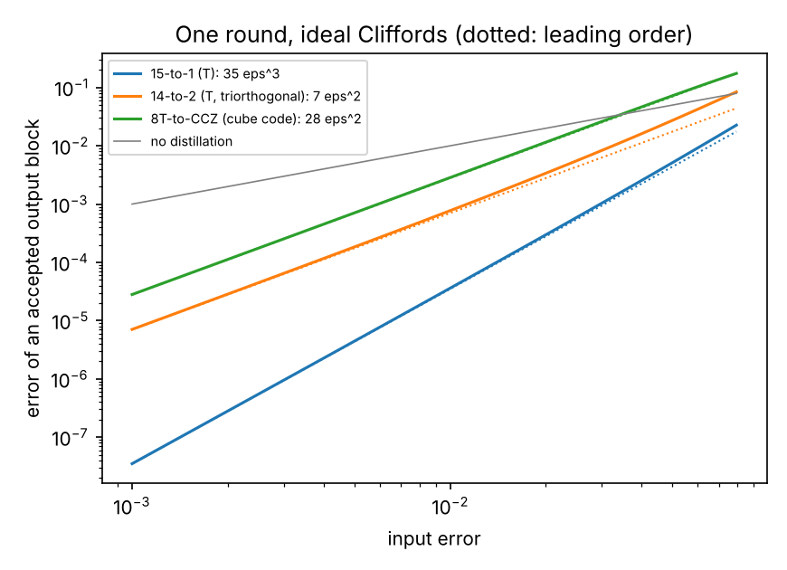

# magic15: 15-to-1 magic-state distillation, simulated and checked

A small, tested reproduction of the Bravyi-Kitaev 15-to-1 distillation protocol at the protocol level: exact enumeration of all
undetected error patterns, a Monte Carlo cross-check, and multi-round error/cost curves.

## Model (and what it does not cover)
- 15 noisy T states, independent Z errors with probability eps (twirled noise).
- Perfect Clifford gates and measurements in the base results (the toy extension below adds Clifford noise); no circuit-level simulation.
- Accept iff the Hamming syndrome H e = 0; an accepted pattern is a logical error iff its weight is odd.

## Results (checked by `pytest`)
- 2048 undetected patterns, of which 35 have weight 3 (minimum distance 3).
- Output error = 35 eps^3 + O(eps^4)-order corrections; acceptance = 1 - 15 eps + O(eps^2).
- Monte Carlo agrees with exact enumeration within 5 standard errors.
- Example (eps0 = 0.01): round 1 -> 3.6e-5 (17.4 raw T per output), round 2 -> 1.6e-12 (about 262), round 3 -> 1.6e-34 (about 3900).

## Run
    pip install numpy matplotlib pytest
    python -m pytest -q
    PYTHONPATH=. python scripts/make_figures.py

## Extension: a noise floor from imperfect Cliffords (toy model)
`magic15/noisy.py` adds one parameter p for the noise of the Clifford operations: every input qubit gets an extra independent Z error with
probability p (encoding noise) and the output qubit gets one more with probability p (output noise).

- With p = 0 it reproduces the ideal results exactly (tested).
- With p > 0 the output error stops improving at about p: starting from 0.01, five rounds give 1.0e-5, 1.0e-4 and 1.0e-3 for p = 1e-5, 1e-4, 1e-3, against 1e-34 and below for ideal Cliffords. To leading order the output error is 35 eps_eff^3 + p.
- Monte Carlo agrees with the exact calculation within 5 standard errors (tested).

**This is a phenomenological toy model, not a circuit-level simulation.** It does not say where faults occur in a real distillation circuit, ignores correlated
faults and measurement errors, and its floor of exactly p is a property of the model. It illustrates why the noise of the operations sets
the achievable output error; realistic numbers need a circuit-level treatment.

Run: `PYTHONPATH=. python scripts/make_noisy_figure.py` (Windows: `set PYTHONPATH=.` first).

## Other protocols: what extends easily and what does not
`magic15/css.py` replaces the hardcoded 15-qubit logic with a general description. A protocol is a pair of binary matrices: `Hx` (X stabilisers: a Z-error pattern is accepted iff `Hx e = 0`) and `K` (X-type operators commuting with every Z stabiliser: an accepted pattern is harmless iff `K e = 0`). Triorthogonal-matrix protocols (Bravyi-Haah) and any CSS code with a known transversal gate plug in directly. Exact enumeration, Monte Carlo, round-chaining and heterogeneous per-qubit noise then come for free.

| protocol | inputs -> outputs | leading error | acceptance at eps = 1% | one-round threshold |
|---|---|---|---|---|
| 15-to-1 (Bravyi-Kitaev) | 15 T -> 1 T | 35 eps^3 | 0.860 | 0.1415 |
| 14-to-2, triorthogonal | 14 T -> 2 T | 7 eps^2 | 0.869 | 0.076 |
| 8T-to-CCZ, cube code | 8 T -> 1 CCZ | 28 eps^2 | 0.925 | 0.034 |

How these were checked:
- The general code reproduces the original 15-to-1 results to 1e-12 and the 0.1415 threshold (the commonly quoted figure for this protocol with ideal Cliffords is about 14.1%).
- The 14-to-2 matrix was found by a randomised search in this repo, not copied from a paper. It is triorthogonal (checked) and its leading error 7 eps^2 equals the published Bravyi-Haah coefficient (1 + 3k) eps^2 for k = 2. Searches for k = 1, 3, 4 found nothing in the time I gave them: that is a weakness of the search, not evidence about the formula. It is not claimed to be the paper's exact matrix.
- The cube code's 28 eps^2 agrees with the value I recall from the literature for 8T-to-CCZ; I have not re-checked it against the paper.
- A negative control: the 7-qubit Steane code is refused, because it is not triorthogonal (transversal T is not a logical T there). Without that check the framework would confidently report 7 eps^3 for a protocol that does not work.

Limits, stated plainly:
- The analysis assumes the protocol is valid (the circuit really implements the target gate). The code checks triorthogonality for T-type protocols; it cannot check a circuit.
- Independent Z noise on the inputs, perfect Cliffords and measurements. Real error floors need a circuit-level model; the `noisy` toy model is not that.
- Output blocks with k > 1 outputs are scored as "any output wrong"; per-output errors and their correlations are not modelled, so chaining rounds of multi-output protocols is only approximate.
- The comparison table counts raw input states, not space-time volume, so it does not rank protocols for real hardware. CCZ outputs and T outputs are not directly comparable.
- Magic state cultivation does not fit this framework at all: it relies on post-selection during growth of a code and on circuit-level fault propagation, which needs a stabiliser-circuit simulator (for example Stim).

## Next steps (not done)
Circuit-level noise (for example with Stim); a stronger search or the published construction for other Bravyi-Haah sizes; magic-state cultivation; connection to qLDPC code constructions.

## References
Bravyi and Kitaev, "Universal quantum computation with ideal Clifford gates and noisy ancillas" (2005); Litinski, "Magic state distillation: not as costly as you think" (2019); Gidney, Shutty and Jones, "Magic state cultivation" (2024).
