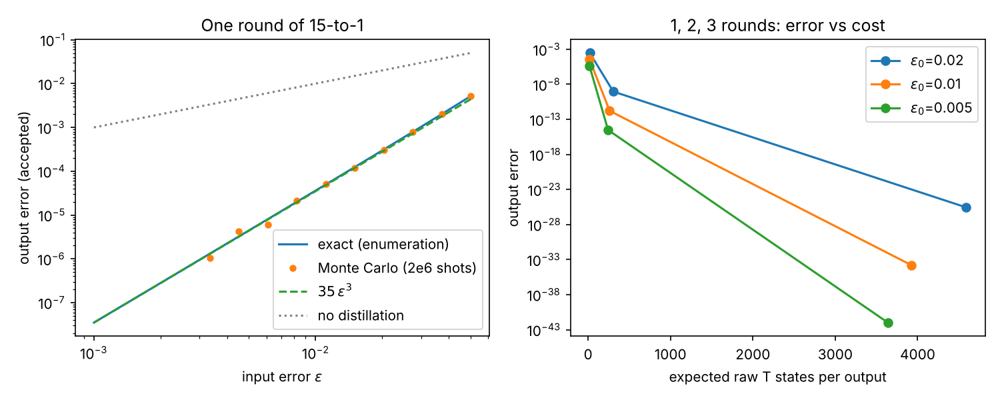
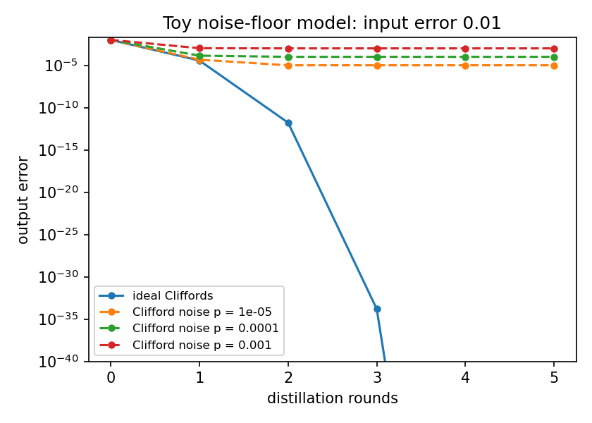

# magic15: 15-to-1 magic-state distillation, simulated and checked

A small, tested reproduction of the Bravyi-Kitaev 15-to-1 distillation protocol at the protocol level: exact enumeration of all
undetected error patterns, a Monte Carlo cross-check, and multi-round error/cost curves.

## Model (and what it does not cover)
- 15 noisy T states, independent Z errors with probability eps (twirled noise).
- Perfect Clifford gates and measurements in the base results (the toy extension below adds Clifford noise); no circuit-level simulation.
- Accept iff the Hamming syndrome H e = 0; an accepted pattern is a logical error iff its weight is odd.

## Results (checked by `pytest`)
- 2048 undetected patterns, of which 35 have weight 3 (minimum distance 3).
- Output error = 35 eps^3 + O(eps^4)-order corrections; acceptance = 1 - 15 eps + O(eps^2).
- Monte Carlo agrees with exact enumeration within 5 standard errors.
- Example (eps0 = 0.01): round 1 -> 3.6e-5 (17.4 raw T per output), round 2 -> 1.6e-12 (about 262), round 3 -> 1.6e-34 (about 3900).

## Run
    pip install numpy matplotlib pytest
    python -m pytest -q
    PYTHONPATH=. python scripts/make_figures.py

## Extension: a noise floor from imperfect Cliffords (toy model)
`magic15/noisy.py` adds one parameter p for the noise of the Clifford operations: every input qubit gets an extra independent Z error with
probability p (encoding noise) and the output qubit gets one more with probability p (output noise).

- With p = 0 it reproduces the ideal results exactly (tested).
- With p > 0 the output error stops improving at about p: starting from 0.01, five rounds give 1.0e-5, 1.0e-4 and 1.0e-3 for p = 1e-5, 1e-4, 1e-3, against 1e-34 and below for ideal Cliffords. To leading order the output error is 35 eps_eff^3 + p.
- Monte Carlo agrees with the exact calculation within 5 standard errors (tested).

**This is a phenomenological toy model, not a circuit-level simulation.** It does not say where faults occur in a real distillation circuit, ignores correlated
faults and measurement errors, and its floor of exactly p is a property of the model. It illustrates why the noise of the operations sets
the achievable output error; realistic numbers need a circuit-level treatment.

Run: `PYTHONPATH=. python scripts/make_noisy_figure.py` (Windows: `set PYTHONPATH=.` first).

## Next steps (not done)
Circuit-level noise (for example with Stim); comparison with other protocols and with magic-state cultivation; connection to qLDPC code constructions.

## References
Bravyi and Kitaev, "Universal quantum computation with ideal Clifford gates and noisy ancillas" (2005); Litinski, "Magic state distillation: not as costly as you think" (2019); Gidney, Shutty and Jones, "Magic state cultivation" (2024).
